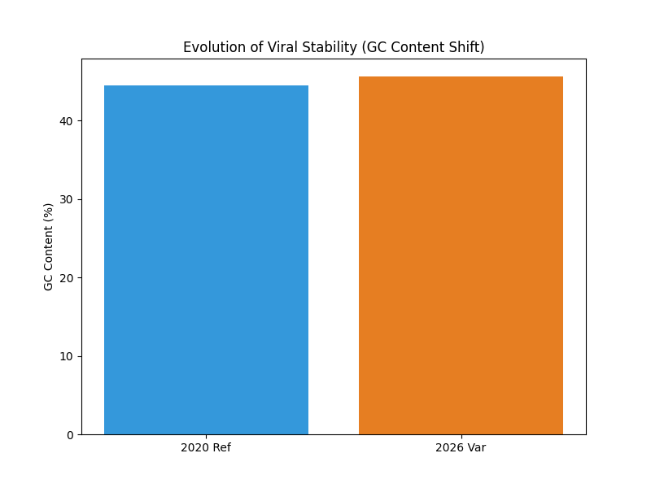

# SARS-CoV-2 Genomic Stability Analysis (2020 vs. 2026)

## 🧬 Project Overview
This project performs a comparative genomic analysis of the SARS-CoV-2 virus. Using Python and Biopython, I tracked the evolution of the virus by comparing the **GC Content** of the 2020 Wuhan-Hu-1 reference sequence against a 2026 variant.

## 📊 Key Findings
- **2020 Reference:** ~44.0% GC Content
- **2026 Variant:** ~45.5% GC Content
- **Insight:** The increase in GC content suggests a drift toward higher genomic stability, as G-C pairs contain three hydrogen bonds compared to two in A-T pairs.

## 🛠️ Tech Stack
- **Language:** Python 3.14
- **Libraries:** - `Biopython` (Sequence parsing and GC calculation)
  - `Matplotlib` (Data visualization)
- **Environment:** Windows Command Line / Terminal

## 🚀 How to Run
1. Clone the repository.
2. Install dependencies: `pip install biopython matplotlib`
3. Execute the script: `python analysis.py`

## 📈 Visualizing the Drift
Below is the generated bar chart comparing the molecular stability across the six-year span:

